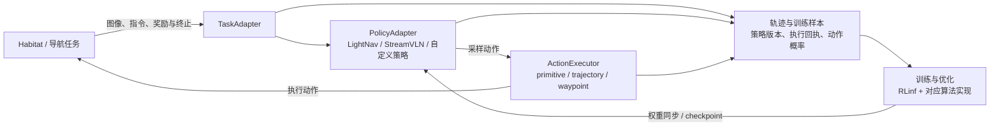

<div align="center">
  
  <h1>RLinf-VLN</h1>
  <p><strong>视觉语言导航的仿真、采样与强化学习实验工具链</strong></p>
  <p>Habitat · Policy Adapters · RLinf · Reproducible Experiments</p>
  <p>
    <a href="#快速开始">快速开始</a> ·
    <a href="#架构">架构</a> ·
    <a href="#模型与算法路线">模型与算法路线</a> ·
    <a href="extensions/navigation/REMOTE_WORKFLOW.md">远端开发与实验追踪</a>
  </p>
</div>

## 项目定位

RLinf-VLN 是 [CantonMonkey/RLinf](https://github.com/CantonMonkey/RLinf) 的导航扩展，
在 `navigation-vln` 分支开发。它把 **Habitat 仿真、视觉语言导航模型与 RLinf 训练组件**
连接起来，支持从模型闭环推理、轨迹采集到策略更新、checkpoint 恢复和评估的实验流程。

本项目基于上游 RLinf，导航扩展由本 fork 维护。RLinf 提供训练基础设施，Habitat 提供
环境与传感器，LightNav、StreamVLN 等模型通过适配器提供导航决策。

## 可以做什么

| 用途 | 具体工作 |
| --- | --- |
| 推理与回放 | 根据图像和语言指令执行导航，检查动作、轨迹、STOP、碰撞与失败原因 |
| 收集 rollout | 记录观察、采样动作、实际执行动作、奖励、终止状态和策略版本 |
| 训练导航策略 | 研究奖励、动作分布、轨迹修正与高层决策，比较更新前后的表现 |
| 接入不同模型 | 实现策略、任务与执行适配器，复用公共采样、PPO、checkpoint 和指标组件 |
| 复现与迁移 | 将源码、部署配置、数据、权重和输出绑定到同一次实验，保留可恢复的版本记录 |

相机帧与视频可以在远端离屏生成，完成后下载到本地查看，无需实时打开仿真窗口。
具体渲染后端仍需在目标机器上验证。

## 架构



- **TaskAdapter**：统一 reset、step、策略可见观察、奖励和终止状态。
- **PolicyAdapter**：统一 sample、evaluate、bootstrap、状态重置与可训练参数。
- **ActionExecutor**：把模型输出转换为环境动作，记录实际执行长度及结果。
- **通用 stack**：提供执行回执、变时长 return/GAE、on-policy replay、PPO、
  checkpoint 和指标合同；模型特定表示与算法留在对应集成中。

更换模型时，需要明确实际优化的动作分布，并验证采样概率、重放概率与执行回执一致。
环境中的目标位置、参考路径等特权信息按任务合同隔离，不能混入仅使用图像和指令的策略输入。

## 模型与算法路线

| 路线 | 模型与动作 | 训练方式与用途 |
| --- | --- | --- |
| 小型 PointNav / VLN 策略 | 离散导航动作 | 轻量基线、协议检查与有界 PPO 实验 |
| StreamVLN 适配 | 基于 backbone 的导航动作 chunk | 已有 LoRA/value PPO 集成；需遵守上下文、动作概率与执行长度合同 |
| LightNav A3 | 冻结 LightNav 的原生轨迹 proposal，训练小型决策与 residual/value head | PPO；研究保持轨迹、有限调整与 STOP |
| **Navigation-RLT** | 冻结 LightNav 的上下文表示 + 因果拓扑，学习 256 维 RL token | 当前主线：表示学习后，以 twin-Q、有限候选 CQL、参考策略与行为约束训练决策 |

Navigation-RLT 的两阶段分别学习 token 表示和决策策略。动作定义包含
`KEEP / ADJUST / STOP / RECOVER`；可执行动作受编译有效性与行为支持掩码约束，
`RECOVER` 还需要有效的因果恢复父节点。历史首轮配置屏蔽了没有正样本支持的 RECOVER。
这条路线应按其具体训练目标理解，不能直接等同于 A3 的 PPO 或标准 SAC。

## 快速开始

### 1. 获取导航分支

```bash
git clone --branch navigation-vln https://github.com/CantonMonkey/RLinf.git
cd RLinf/extensions/navigation
```

已有 checkout 时，先检查 Git 状态与正在使用该目录的任务，再按
[远端工作流](extensions/navigation/REMOTE_WORKFLOW.md) 同步。

### 2. 运行最小示例

使用 **Python 3.10+**，以下命令仅依赖标准库，无需 GPU、Habitat 或模型权重：

```bash
python -B -m scripts.smoke_env --policy oracle --episodes 10 --seed 7
python -B -m unittest discover -s tests -p test_stack_core.py
```

第一条运行确定性 grid mock 的 oracle 导航，第二条检查核心合同。
它们用于理解环境接口与验证基础行为；输出的 success/SPL 只属于该 mock，不能当作真实 VLN 成绩。

### 3. 开展真实仿真实验

1. **选任务和模型**：固定 episode split、模型版本、checkpoint、动作空间与执行器。
2. **准备环境与资产**：安装匹配的 RLinf/Habitat 环境，按各自授权准备场景、数据和权重。
3. **生成部署配置**：填写本机路径、Python、GPU、网络、存储与唯一 run 输出目录。
4. **做有界闭环检查**：确认观察→动作→反馈，以及动作概率、终止和 checkpoint 恢复正确。
5. **运行与比较**：根据算法收集 rollout 或准备 replay，完成更新后，在相同 episode、
   执行器和预算下与 no-update 基线比较。
6. **保存实验身份**：记录源码/runtime commit、配置与源码摘要、数据/模型身份和结果位置。

**部署说明：** `integrations/rlinf_v03/` 是待安装或整理的集成源码，clone 不会自动把所有
导航模块注册到根目录 `rlinf/`。公开配置含示例路径和设备标识，不能直接启动历史 launcher。
Navigation-RLT 的源码整理方法见 [源码迁移说明](extensions/navigation/P8_HASH_AND_MIGRATION.md)，
模块映射与环境说明见 [集成文档](extensions/navigation/integrations/rlinf_v03/README.md)。

## 计算与仿真怎么部署

| 节点 | 典型职责 | 配置要点 |
| --- | --- | --- |
| Windows 工作站 | 开发、Git 管理、配置实验、查看日志与视频 | 真实 Habitat 任务使用已配置的远端 Linux 环境 |
| A800 服务器 | 模型计算、RL 训练、批量推理 | 可使用已有 CPU 离屏渲染路径；CUDA 计算可用不代表 NVIDIA EGL 已验证 |
| RTX 4090 工作站 | Habitat 渲染、推理与 rollout；资源允许时训练 | 核对显存、并发任务、场景资产与模型所需环境 |

单机或跨机部署都应明确各组件位置。跨机运行需要配置通信与版本同步；启动前检查实际资源，
并为新任务建立独立运行目录。数据和模型不随本源码仓库分发。

## 验证状态

以下为截至 **2026-10-22** 的项目记录摘要，具体配置与结果属于各自运行版本：

- **历史部署**：已有真实 Habitat/VLN rollout、Ray/FSDP GPU 更新、checkpoint 恢复与评估记录。
  LightNav A3 完成过单 seed、train-only 的对照实验；这些记录支持工具链可用于实验。
- **Navigation-RLT**：已有训练与 checkpoint 归档记录，同条件导航评估仍需收尾。
  尚不能据此宣称稳定导航增益或官方 benchmark 复现。
- **本次 fork 同步**：A800 与 4090 各通过 27 项轻量测试、CPU 策略前向/反向、配置组合、
  45 文件源码包检查，以及真实 Habitat 的无相机 reset→转向→STOP。
  这次同步没有重跑 GPU 训练或渲染。

新部署首次运行 GPU 实验时，仍需按所选模型、环境和资源做有界检查。真实机器人部署需要额外的
感知、定位、运动执行与停止机制集成，当前仿真结果不能直接替代真机验证。

## 代码地图与实验追踪

```text
extensions/navigation/
├── navrl/                     # 导航合同、环境与策略适配器
│   └── stack/                 # 采样、执行回执、GAE/PPO 与 checkpoint
├── scripts/                   # mock、Habitat 服务、回放和源码整理工具
├── integrations/rlinf_v03/     # PointNav/VLN、StreamVLN、LightNav、Navigation-RLT
└── tests/                     # 合同、策略、存储和集成检查
```

`main` 用于跟踪上游，`navigation-vln` 用于本 fork 的导航开发。实际部署可能包含私有配置和
补丁，应记录 runtime 的真实提交及 dirty diff。旧实验保留原代码身份，checkpoint、场景与
大日志放在外部存储；新实验使用新的 run ID 与回执。

- [导航扩展开发入口](extensions/navigation/README.md)
- [远端工作流与实验追踪](extensions/navigation/REMOTE_WORKFLOW.md)
- [初次源码导入与来源](NAVIGATION.md)
- [发布检查与历史结果使用边界](extensions/navigation/EXPORT_VALIDATION.md)
- [上游 RLinf 文档](https://rlinf.readthedocs.io/)

## 致谢

本项目使用并扩展 RLinf，相关实验使用 Habitat、LightNav 和 StreamVLN。各依赖、数据与预训练
权重遵循其各自许可证和使用条件；仓库许可见 [LICENSE](LICENSE)。
